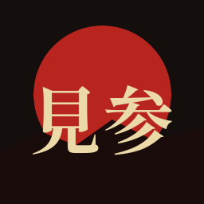

<p align="center">
  
</p>

<h1 align="center">Yakuza Kenzan Recomp</h1>

**Like a Dragon: Kenzan! (PS3, 2008), recompiled into a real PC program for Linux and Windows, in English.**<br>
No emulator while you play.

[](../../releases/latest)
[](#linux)
[](#windows)
[](#how-it-works)
[](#what-you-get)
[](#credits)

</div>

> **Beta.** The whole game boots and plays, minigames included, but it has only been played through by a few
> people on a few PCs. Please [report](../../issues) what you find.

## What this is

Kenzan! never left Japan and never got a PC version. This port takes the game's PS3 code (the PowerPC main
program and its SPU programs), translates it into C/C++ and compiles it for the PC. The game then runs directly on
your CPU, with its graphics drawn through Vulkan, at 1080p and up, at 30, 60 or 120 FPS.

It plays in English thanks to the community translation patch ([credits](#credits)), which the launcher applies
for you when it installs the game.

> **You need your own copy of the game.** The release contains the port (the engine, the launcher and the
> game's recompiled code) but **no game data**: models, textures, sound, video and text all come from your own
> disc, and the English text from the translation patch.

## Install

1. Download the release for your system from the [latest release](../../releases/latest):
   - **Linux:** `Kenzan-x86_64.AppImage`
   - **Windows:** `Kenzan-Windows.zip`, unpacked into a folder on a local drive, for example `C:\Games\Kenzan`
     (not *Program Files*).
2. Start it (`Kenzan-x86_64.AppImage`, or `Kenzan Launcher.exe` on Windows) and open the **Install** tab.
3. Pick **your game** (the disc image `.iso`, or the extracted disc folder that holds `PS3_GAME`) and the
   **English translation patch** (its `.7z`, or its extracted folder). Press **Install**.
4. Press **Play**.

The install copies the disc and applies the translation into the port's own folder, then checks the result
against the executable the port was recompiled from, before it replaces anything. It needs about 23 GB of free
space and takes a few minutes. Your disc image and the patch file are only read, never changed.

**Already installed it with an earlier version?** Do not install again: the **Install** tab finds an earlier
version of the port in the folders around the new one (or press **Use an existing installation…** and pick its
folder). Its game is moved over, with its saves, settings, controls and mods; nothing is installed again.

[!NOTE]
**Already played the translation on RPCS3?** The patch's "Extra Steps (RPCS3 Only)" rename its
files: `EBOOT RPCS3.BIN` becomes `EBOOT.BIN`, and the original `EBOOT.BIN` becomes `EBOOT PS3.BIN`.
The installer currently looks for `EBOOT RPCS3.BIN` by name, so a folder prepared for RPCS3 fails
with *"the translation has no EBOOT RPCS3.BIN"*. Either:
 - point **English translation** at the original patch archive (the `.7z` / `.zip` you downloaded), or
 - in a copy of that folder, rename `USRDIR/EBOOT.BIN` back to `EBOOT RPCS3.BIN`
   (and `EBOOT PS3.BIN` back to `EBOOT.BIN`).

The next update will find the right file by its contents, whatever its name.

### Updates

From v1.0.1 on, the launcher checks GitHub for a newer release when it starts and asks before it changes
anything: **Update now** downloads it, checks it, replaces the port's own files and starts the new version
(your game, saves, settings, controls and mods are kept); **Later** asks again next time; **Skip this version**
does not ask about that one again. If you are on v1.0.0, download v1.0.1 by hand once.

## What you need

- **Ryu ga Gotoku Kenzan!**, the Japanese PS3 disc **BLJM60064** (v1.00), as a decrypted disc image (`.iso`)
  or its extracted folder.
- The **English translation patch** for BLJM60064 (`Ryu_Ga_Gotoku_Kenzan_Translation_Patch`).
- **A PC with:** 64-bit Linux or Windows 10/11, a CPU with AVX2 (Intel 4th gen / AMD Ryzen or newer), a
  graphics card with Vulkan, 16 GB RAM, about 25 GB of free disk space.

## What you get

- **60 FPS** (the default) or **120 FPS** for the whole game, at its original speed, with the
  [community frame-rate patches](#credits) built in, minigames included. 30 FPS plays the game as shipped.
- **Native 1080p and up:** internal resolution 720p / 1080p / 1440p / 4K, with SMAA or FXAA, MSAA, sharpening
  and anisotropic filtering.
- **All the minigames:** shogi, mahjong, hanafuda, karuta, chō-han and the other dice games, bowling, the turtle
  race, the archery and the rest. They are recompiled like the main game.
- **Any controller, plug and play,** or keyboard and mouse; every button can be remapped.
- **An in-game settings menu,** a frame-rate counter and the original PS3 look on a key.
- **Saves** in the port's folder, in the PS3's own format.
- **Mods:** the launcher's **Mods** tab adds mod `.zip` files and turns them on or off (see [Mods](#mods)).
- **Shaders ready from the first start:** the release ships the game's shaders already translated, so the first
  session does not stutter while they are built.

### Keys

| Key | Action |
|---|---|
| **F1** | fps counter |
| **F2** | the port's settings menu |
| **F3** | your picture vs the original PS3 look |
| **Alt+Enter** | fullscreen |

The game itself uses the controller's buttons; on the keyboard they are remappable in the launcher's
**Controls** tab or in F2 → Controls. The mouse cursor is hidden while you play and comes back with the F2 menu.

## Linux

`Kenzan-x86_64.AppImage` runs on any recent 64-bit distribution: it carries its own libraries and uses your
system's graphics driver. Make it executable (`chmod +x`) and start it. The first start adds a shortcut to your
applications menu.

Your settings, the installed game, saves and logs are in `~/.local/share/kenzan-port/`, and the shader cache in
`~/.cache/kenzan-port/`. To uninstall, delete those two folders, the AppImage, and
`~/.local/share/applications/kenzan-port.desktop`.

## Windows

`Kenzan Launcher.exe` and the `engine` folder next to it are the whole port; nothing is installed into Windows
and no Visual C++ runtime is needed. Settings (`kenzan.ini`, `input.toml`), the installed game (`game\`), saves
and logs (`work\`) live in the same folder: move or copy the folder and it still plays. To uninstall, delete it.

The programs are not code-signed, so Windows SmartScreen may warn the first time: **More info → Run anyway**.

## Mods

Kenzan's community mods are files that take the place of the game's own (for example `sh_iori_ps3.par` in
`bin/shader`, or `mail.bin` in `bin/scenario`). Here they are never copied over the game:

1. In the launcher, **Mods → Add mod (.zip)…** and pick the mod's zip. It becomes a folder in the port's `mods`
   folder (**Open mods folder**), one folder per mod.
2. Untick a mod to turn it off. That is all it takes to undo it.

A file in a mod's folder replaces the game file with the same path under `USRDIR`, or, if it sits alone at the
top of the mod (as most of these zips have it), the one game file with that name. The **Log** tab lists what each
mod replaced (`[mods]` lines). Two mods that change the same file: the first one (by name) wins, and the log
says so.

## FAQ

**Where are my saves?**
`work/gamedata/dev_hdd0/home/00000001/savedata` inside the port's data folder (Linux:
`~/.local/share/kenzan-port/`, Windows: the port's folder). They are PS3 saves: you can copy them in and out.

**Can I use saves from RPCS3?**
Yes: copy the `BLJM60064…` folders from RPCS3's `dev_hdd0/home/00000001/savedata` into the folder above.

**The game looks or runs wrong, or closes.**
Please [open an issue](../../issues) with your PC's CPU and graphics card, what you were doing, and the log:
`work/logs/last_run_err.txt` (the launcher's **Log** tab shows it and opens its folder).

**Does it work with the original Japanese text?**
The launcher installs the English version only: the port is recompiled from the translated executable, and the
install checks that it is that one.

## How it works

- [ps3recomp](https://github.com/sp00nznet/ps3recomp) translates the game's PPU (PowerPC) code, its SPU programs,
  its minigame modules and the PS3 firmware modules it needs into C/C++, which clang compiles into the game
  module (`libInfamous2Game*.so` / `KenzanGame*.dll`, one per frame rate).
- The engine stands in for the PS3 system (files, threads, audio, input, saves, system dialogs) and draws the PS3
  graphics chip's commands with Vulkan at any internal resolution.
- The launcher (Rust, egui) installs the game, keeps the settings and starts the engine.

| Folder | What it is |
|---|---|
| [`engine/`](engine/) | The engine: the recompiler (`engine/tools/`) and the runtime (`engine/runtime/`, `engine/libs/`). It comes from [sp00nznet's ps3recomp](https://github.com/sp00nznet/ps3recomp) through the [inFAMOUS 2 port](https://github.com/SamiEnazi/infamous2-port)'s fork, with Kenzan's changes. MIT, [`engine/LICENSE`](engine/LICENSE). |
| `port/` | The Kenzan side of the engine: the entry point, the game's configuration and its glue. |
| `launcher/` | The launcher. |
| `tools/` | The build (`tools/build.sh`), the module builder, and the tools that link and patch the minigame modules. |
| `packaging/` | The Linux AppImage and the Windows folder (cross-built from Linux). |

<details>
<summary>Building from source</summary>

The build needs your own decrypted `EBOOT.BIN`, the minigame modules and the PS3 firmware modules, which are not
in this repository. On Linux (the commands assume NixOS; `shell.nix` lists the dependencies):

```
tools/build.sh                     # the engine and the 30 FPS game module
bash packaging/linux/build_appimage.sh
bash packaging/windows/build_windows.sh   # cross-builds the Windows folder (clang-cl + xwin)
```
</details>

## Credits

- **The English translation** (Like a Dragon: Kenzan! English Patch): **majDima** (hacking, tools),
  **Arcodeaus** (editing, translation), **jurxd** (translation, textures), **PauseForTheCat** (translation,
  tools), **TheEdgyNerd** (msg file identification); with thanks to Egomaniac, Kungfugloves, jole7777 and
  chalk3422 (font atlas). The port would not be in English without them.
- **Pakundo**: the RPCS3 patches *Framerate - Core: 60 FPS / 120 FPS* and *Framerate - Minigames* for this game,
  which the port applies to the game's code before recompiling it.
- **[ps3recomp](https://github.com/sp00nznet/ps3recomp)** by Ned Heller / sp00nznet and its contributors: the
  recompiler and runtime this port is built on (MIT).
- **[inFAMOUS 2 native PC port](https://github.com/SamiEnazi/infamous2-port)** by SamiEnazi and its
  contributors: the engine fork this port started from, with its Vulkan renderer, settings menu and Windows
  support (MIT).
- **[RPCS3](https://github.com/RPCS3/rpcs3)** and its team: the reference we compared the port against, and the
  source of much of what is known about the PS3. **No RPCS3 code is included** (RPCS3 is GPL).
- Third-party libraries, each under its own license: [SDL2](https://libsdl.org) (zlib),
  [Vulkan-Headers](https://github.com/KhronosGroup/Vulkan-Headers) (Apache-2.0),
  [glslang](https://github.com/KhronosGroup/glslang) (BSD-3 and others),
  [Dear ImGui](https://github.com/ocornut/imgui) (MIT), [SMAA](https://github.com/iryoku/smaa) (MIT),
  [egui](https://github.com/emilk/egui) (MIT/Apache-2.0), [7-Zip](https://www.7-zip.org) (LGPL, shipped
  unmodified for the install), and the Shippori Mincho font (SIL OFL 1.1). Their license files are in
  `engine/third_party/`, `launcher/assets/` and the release's `licenses/` folder.

## Legal

This is a fan project for people who own the game. It is not affiliated with or endorsed by SEGA or Sony
Interactive Entertainment. *Ryu ga Gotoku* / *Like a Dragon* is a trademark of SEGA.

This repository contains no game data, firmware or keys. Do not share the game's files or your installed copy.
